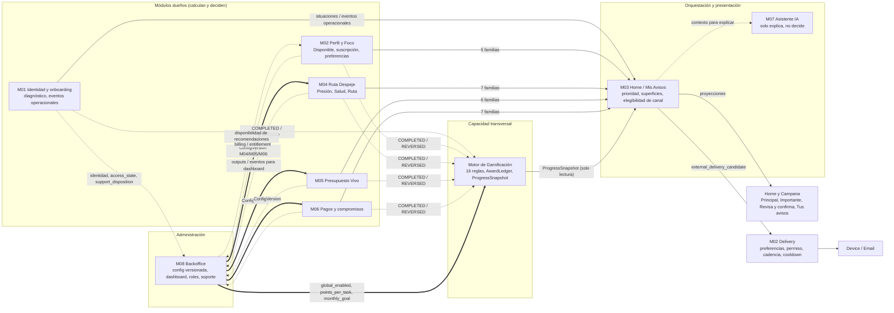
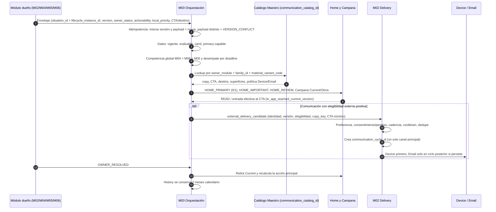
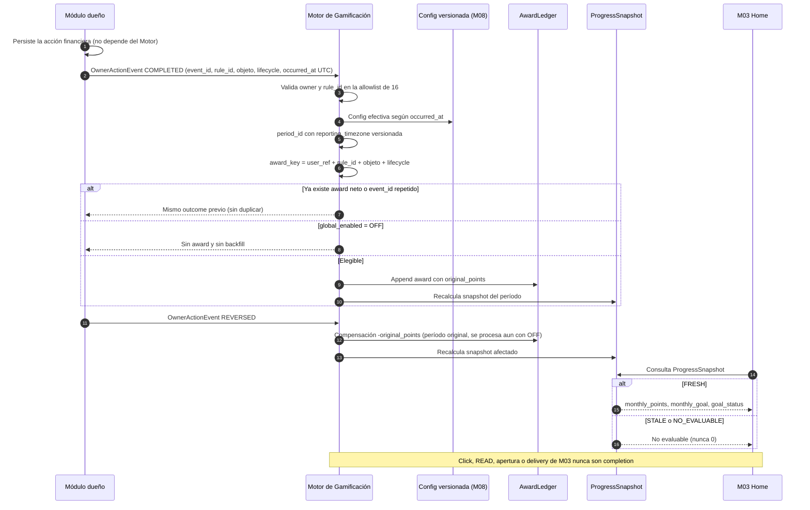
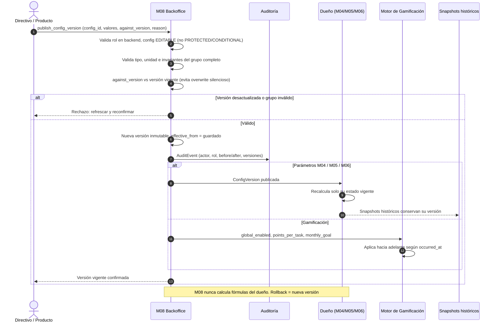

# Cómo se comunican los módulos: Avisos + M03 + Gamificación + M08

Fuente: contratos funcionales y guías Backend de la Entrega Kabeli 2.0 (M03, Mis Avisos, Gamificación, M08). Numeración del cliente. Issue: KabeliDev/back-walvy#351. Son contratos lógicos, no describen el código actual de `back-walvy`.

## 1. Mapa lógico

## 2. Avisos: de la situación a Home, Campana y canal externo

## 3. Gamificación: award, reversión y progreso

## 4. M08: publicación de configuración

## Reglas que los diagramas no muestran
- M07 solo explica lo que M03 ya decidió, no cambia prioridad, comunicación ni canal.
- M03 no envía nada. Un solo canal externo principal por ciclo, Device y Email nunca simultáneos.
- READ no resuelve una situación. Click, READ, apertura o delivery nunca son completion de Gamificación.
- Una falla de Gamificación o de M08 no revierte la acción financiera del dueño.
- El `communication_catalog_id` no es único: el lookup de política es `owner_module + family_id + material_variant_code`.
